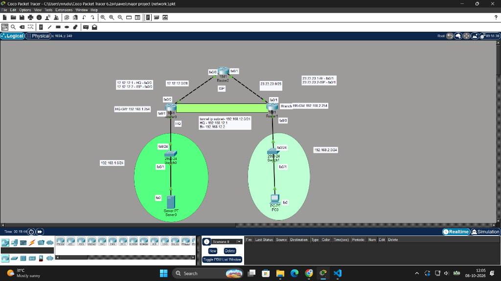

# Network Topology Description

**Project Title:** Virtual Private Network for Multi-Branch Organizations  
**Target Environment:** Cisco Packet Tracer 6.2sv / 7.x / 8.x  
**File Reference:** `C:\Users\mrudu\Cisco Packet Tracer 6.2sv\saves\major project (network ).pkt`

---

## 1. Overview & Architecture

This project models an enterprise Site-to-Site Virtual Private Network (VPN) connecting a Headquarters (HQ) site and a geographically distant Branch Office across an untrusted Internet Service Provider (ISP) network. The architecture establishes a secure, encrypted IPsec communication channel that allows internal hosts (HQ Server0 and Branch PC0) to communicate transparently using private IPv4 addressing without exposing plaintext traffic to the public internet.

### Network Architecture Diagram


### Cisco Packet Tracer Lab Simulation (`major project (network ).pkt`)


---

## 2. Network Topology Diagram (ASCII Representation)

```
====================================================================================================
  HEADQUARTERS SITE (HQ)                  ISP TRANSIT CORE                    BRANCH SITE
  [192.168.1.0/24]                      [PUBLIC INTERNET]                  [192.168.2.0/24]
====================================================================================================

+-----------------------+                                               +-----------------------+
|        Server0        |                                               |          PC0          |
|    192.168.1.10/24    |                                               |    192.168.2.10/24    |
|   GW: 192.168.1.254   |                                               |   GW: 192.168.2.254   |
+-----------+-----------+                                               +-----------+-----------+
            | Fa0 (Copper Straight-Through)                                         | Fa0 (Copper Straight-Through)
            v                                                                       v
+-----------+-----------+                                               +-----------+-----------+
|    HQ Switch (2960)   |                                               |  Branch Switch (2960) |
|       [Switch0]       |                                               |       [Switch1]       |
+-----------+-----------+                                               +-----------+-----------+
            | Fa0/1 (Copper Straight-Through)                                       | Fa0/1 (Copper Straight-Through)
            v                                                                       v
+-----------+-----------+                                               +-----------+-----------+
|    HQ Router (1841)   |                                               |  Branch Router (1841) |
|      [Router0]        |                                               |       [Router1]       |
| LAN Fa0/1:            |                                               | LAN Fa0/0:            |
|   192.168.1.254/24    |                                               |   192.168.2.254/24    |
| WAN Fa0/0:            |                                               | WAN Fa0/1:            |
|   12.12.12.1/28       |                                               |   23.23.23.2/28       |
+-----------+-----------+                                               +-----------+-----------+
            |                                                                       |
            | WAN Fa0/0                                                   WAN Fa0/1 |
            | (Copper Cross-Over / Straight)                             (Cross-Over| / Straight)
            | 12.12.12.0/28 Link                                 23.23.23.0/28 Link |
            |                                                                       |
            +-----------------------> +-------------------+ <-----------------------+
                                      | ISP Router (1841) |
                                      |     [Router2]     |
                                      | Fa0/0: 12.12.12.2 |
                                      | Fa0/1: 23.23.23.1 |
                                      +-------------------+

   <=============================================================================>
              SECURE IPSEC ENCRYPTED VPN TUNNEL (192.168.12.0/24)
              Between Router0 (12.12.12.1) <===> Router1 (23.23.23.2)
   <=============================================================================>
```

---

## 3. Detailed Node Breakdown

### 3.1 Headquarters (HQ) Network
* **HQ Router (`Router0`)**:
  * **Model**: Cisco 1841 Modular Integrated Services Router.
  * **Role**: HQ Gateway & IPsec VPN Initiator/Responder.
  * **LAN Interface (`Fa0/1`)**: `192.168.1.254/24` (Connects to internal LAN switch).
  * **WAN Interface (`Fa0/0`)**: `12.12.12.1/28` (Connects to ISP Router2 Fa0/0).
  * **Tunnel Virtual IP**: `192.168.12.1/24` *(Route-based reference)*.
* **HQ Switch (`Switch0`)**:
  * **Model**: Cisco Catalyst 2960-24TT.
  * **Role**: Layer 2 distribution for HQ local devices.
* **HQ Server (`Server0`)**:
  * **Interface**: `FastEthernet0`
  * **IP Address**: `192.168.1.10`
  * **Subnet Mask**: `255.255.255.0` (`/24`)
  * **Default Gateway**: `192.168.1.254`
  * **Role**: Centralized corporate services (HTTP, DNS, FTP, Database).

---

### 3.2 Branch Office Network
* **Branch Router (`Router1`)**:
  * **Model**: Cisco 1841 Modular Integrated Services Router.
  * **Role**: Branch Gateway & IPsec VPN Initiator/Responder.
  * **LAN Interface (`Fa0/0`)**: `192.168.2.254/24` (Connects to internal Branch switch).
  * **WAN Interface (`Fa0/1`)**: `23.23.23.2/28` (Connects to ISP Router2 Fa0/1).
  * **Tunnel Virtual IP**: `192.168.12.2/24` *(Route-based reference)*.
* **Branch Switch (`Switch1`)**:
  * **Model**: Cisco Catalyst 2960-24TT.
  * **Role**: Layer 2 distribution for Branch workstations.
* **Branch Client (`PC0`)**:
  * **Interface**: `FastEthernet0`
  * **IP Address**: `192.168.2.10`
  * **Subnet Mask**: `255.255.255.0` (`/24`)
  * **Default Gateway**: `192.168.2.254`
  * **Role**: Remote client requesting corporate data.

---

### 3.3 Internet Service Provider (ISP) Core Network
* **ISP Router (`Router2`)**:
  * **Model**: Cisco 1841 Modular Integrated Services Router.
  * **Role**: Public backbone transit node.
  * **HQ Uplink (`Fa0/0`)**: `12.12.12.2/28`
  * **Branch Uplink (`Fa0/1`)**: `23.23.23.1/28`
  * **Routing Logic**: Maintains routing ONLY for public connected links `12.12.12.0/28` and `23.23.23.0/28`. It has zero knowledge of private corporate subnets, demonstrating realistic internet routing and necessity of IPsec encapsulation.

---

## 4. Physical Connection & Cabling Matrix

| Source Device | Source Port | Target Device | Target Port | Cable Type in Packet Tracer | Speed/Duplex |
| :--- | :--- | :--- | :--- | :--- | :--- |
| **Server0** | `FastEthernet0` | **Switch0** | `FastEthernet0/2` | Copper Straight-Through | 100 Mbps / Auto |
| **Switch0** | `FastEthernet0/1` | **Router0** | `FastEthernet0/1` | Copper Straight-Through | 100 Mbps / Auto |
| **Router0** | `FastEthernet0/0` | **Router2 (ISP)** | `FastEthernet0/0` | Copper Cross-Over / Straight* | 100 Mbps / Auto |
| **Router2 (ISP)** | `FastEthernet0/1` | **Router1** | `FastEthernet0/1` | Copper Cross-Over / Straight* | 100 Mbps / Auto |
| **Router1** | `FastEthernet0/0` | **Switch1** | `FastEthernet0/1` | Copper Straight-Through | 100 Mbps / Auto |
| **Switch1** | `FastEthernet0/2` | **PC0** | `FastEthernet0` | Copper Straight-Through | 100 Mbps / Auto |

*\*Note on Router-to-Router Cabling:* In Cisco Packet Tracer, router-to-router FastEthernet links normally use **Copper Cross-Over** cables (or Auto-MDIX supported Straight-Through cables). Verify in Packet Tracer that the link lights turn green after applying `no shutdown`.

---

## 5. Summary of Subnet Allocations

1. **HQ Local Subnet:** `192.168.1.0/24` (`255.255.255.0`)
   - Usable Host Range: `192.168.1.1` – `192.168.1.253`
   - Gateway: `192.168.1.254`
2. **Branch Local Subnet:** `192.168.2.0/24` (`255.255.255.0`)
   - Usable Host Range: `192.168.2.1` – `192.168.2.253`
   - Gateway: `192.168.2.254`
3. **HQ-to-ISP WAN Subnet:** `12.12.12.0/28` (`255.255.255.240`)
   - Usable Host Range: `12.12.12.1` – `12.12.12.14`
   - HQ Interface: `12.12.12.1`, ISP Interface: `12.12.12.2`
4. **Branch-to-ISP WAN Subnet:** `23.23.23.0/28` (`255.255.255.240`)
   - Usable Host Range: `23.23.23.1` – `23.23.23.14`
   - ISP Interface: `23.23.23.1`, Branch Interface: `23.23.23.2`
5. **Virtual VPN Tunnel Subnet:** `192.168.12.0/24` (`255.255.255.0`)
   - HQ Virtual IP: `192.168.12.1`
   - Branch Virtual IP: `192.168.12.2`
